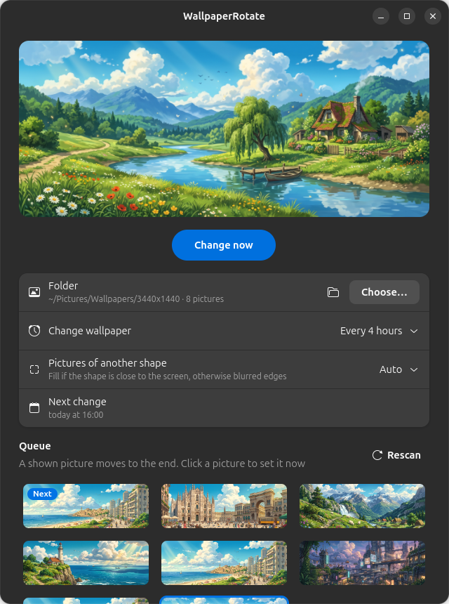

# WallpaperRotate

Scheduled wallpaper rotation for GNOME, with a fair show queue and a small app to manage it.



## Features

- Changes the wallpaper on its own: every hour, every 2, 3, 4, 6 or 12 hours, or once a day. Runs as a systemd user timer, so it works with the app closed.
- **Show queue.** Pictures that were never shown come first (in the order they were added to the folder), then the rest, from the least to the most recently shown. A shown picture moves to the end of the queue, so nothing repeats until every picture has been shown.
- **Pictures of any shape.** If a picture doesn't match the screen (a 16:9 picture on an ultrawide, a portrait photo), it is shown whole over a blurred, darkened copy of itself instead of being cropped. Pictures with nearly the same shape just fill the screen. You can switch to always fill (crop), black bars or blurred edges.
- New pictures are picked up automatically: the folder is re-read before every change.
- Show history is always kept; deleted files drop out of it on their own.
- The WallpaperRotate app:
  - preview of the current wallpaper and a **Change now** button;
  - folder, interval and fit mode settings, time of the next change;
  - thumbnails in queue order with **Next** and **New** badges, plus **Cropped**, **Blurred edges** / **Black bars** and **Low res** badges that show how each picture will look on your screen; click one to set it right away;
  - a **Rescan** button.
- Formats: jpg, jpeg, png, webp. The picture is set for both the light and the dark style.
- If the computer was off when a change was due, the wallpaper changes right after it starts.

## Install

You need GNOME, Python 3 and the GTK 4 / libadwaita bindings (already present on Ubuntu with GNOME):

```bash
sudo apt install python3-gi gir1.2-gtk-4.0 gir1.2-adw-1
```

```bash
git clone https://github.com/pelkons/WallpaperRotate.git
```

```bash
bash WallpaperRotate/install.sh
```

The installer puts everything into your home folder, no sudo needed:

| What | Where |
|---|---|
| rotation script | `~/.local/bin/wallpaper-rotate` |
| app | `~/.local/bin/wallpaper-rotate-app` |
| menu entry and icon | `~/.local/share/applications/`, `~/.local/share/icons/` |
| timer (every 4 hours by default) | `~/.config/systemd/user/wallpaper-rotate.timer` |

Pictures are taken from `~/Pictures/Wallpapers` by default; you can pick another folder in the app.

## Pictures of another shape

The screen size is taken from GNOME (the primary monitor). For each picture:

| Mode | Same shape (±3%) | Close shape (±10%) | Different shape |
|---|---|---|---|
| **Auto** (default) | fill | fill, slight crop | whole picture, blurred edges |
| Fill screen, crop edges | fill | fill, crop | fill, crop |
| Whole picture, black bars | fill | black bars | black bars |
| Whole picture, blurred edges | fill | blurred edges | blurred edges |

A picture is marked **Low res** when it has to be enlarged more than 1.5× and will look blurry.
Composed pictures are cached in `~/.cache/wallpaper-rotate` (only the last few are kept).

## Command line

```bash
wallpaper-rotate                      # next picture in the queue
wallpaper-rotate ~/Pictures/beach.jpg # a specific picture
wallpaper-rotate --queue              # print the queue
```

```bash
systemctl --user list-timers wallpaper-rotate.timer   # when the next change is due
journalctl --user -u wallpaper-rotate                 # change log
```

## Files

- settings: `~/.config/wallpaper-rotate/settings`
  - `WALLPAPER_DIR=` — folder; the `WALLPAPER_DIR` environment variable takes precedence;
  - `FIT_MODE=` — `auto`, `fill`, `fit` or `blur`; the `WALLPAPER_FIT` environment variable takes precedence;
- interval: `~/.config/systemd/user/wallpaper-rotate.timer.d/interval.conf`;
- show history: `~/.local/state/wallpaper-rotate/history` (`time<TAB>path` lines).

## Uninstall

```bash
systemctl --user disable --now wallpaper-rotate.timer
```

```bash
rm -rf ~/.local/bin/wallpaper-rotate ~/.local/bin/wallpaper-rotate-app ~/.config/systemd/user/wallpaper-rotate.* ~/.config/wallpaper-rotate ~/.local/state/wallpaper-rotate ~/.cache/wallpaper-rotate ~/.local/share/applications/*WallpaperRotate.desktop ~/.local/share/icons/hicolor/scalable/apps/*WallpaperRotate.svg
```

## License

[MIT](LICENSE)
